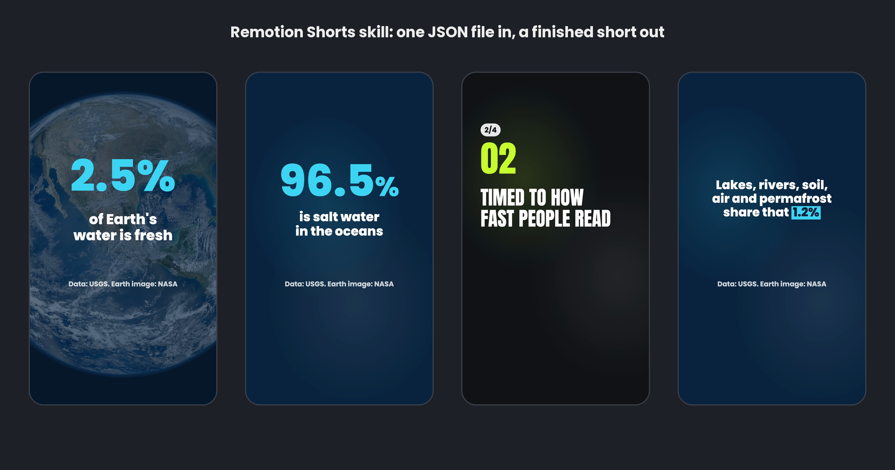

# Remotion Shorts Skill for Claude Code, Codex, Cursor and OpenClaw

**Remotion Shorts Skill** is a free, open-source Remotion skill for Claude Code and other AI agents that makes finished vertical short videos with [Remotion](https://www.remotion.dev) and posts them to TikTok, Instagram Reels and YouTube Shorts. You give your agent a topic, an article, a dataset, a changelog or a list. It writes the script as one JSON file, and the bundled Remotion project turns that into a 1080x1920 kinetic-text short:

- big animated words, stat count-ups, top-N list items, quotes, launch and changelog scenes;
- every scene timed to reading speed;
- every word kept clear of the buttons and captions each app draws on top of the video;
- a review sheet of every scene, and of the frames around every cut, before the video renders;
- sound effects made for the template (hook hit, cut whoosh, highlight pop, count ticks), safe on every app;
- posting to all three apps after you say yes.

Rendering runs on your own machine with Node. No paid API, no Remotion code to write. The skill is MIT licensed; Remotion itself has [its own licence](#licence).

```bash
npx skills add social-media-skills/remotion-shorts-skill -g -a claude-code -y
```



*Frames from the two examples in [`examples/`](skills/remotion-shorts-skill/examples/): a 22-second stat short on Earth's water, with figures from the USGS Water Science School and a NASA image, and a 14-second launch list. Both scripts were written by an AI agent with this skill. See [CREDITS](skills/remotion-shorts-skill/examples/water/CREDITS.md).*

## Contents

- [What the Remotion Shorts skill does](#what-the-remotion-shorts-skill-does)
- [Requirements](#requirements)
- [Install](#install)
- [Example: make a Remotion short with Claude Code](#example-make-a-remotion-short-with-claude-code)
- [Scenes and templates](#scenes-and-templates)
- [What it checks](#what-it-checks)
- [Posting to TikTok, Reels and Shorts](#posting-to-tiktok-reels-and-shorts)
- [What it won't do](#what-it-wont-do)
- [FAQ](#faq)
- [What's inside](#whats-inside)
- [Licence](#licence)

## What the Remotion Shorts skill does

Tell your agent "make a short about X", "turn this changelog into a TikTok" or "top 5 list video for Shorts" and it does the whole job:

1. **Sets up once.** `setup.mjs` copies a tested Remotion project, installs pinned packages and downloads the headless browser Remotion renders with.
2. **Asks only what it can't see:** the source material, the one takeaway, the look (a theme or your brand colours) and where the short goes.
3. **Writes the script** as `short.json`: a hook that states the payoff in about 10 words, one idea per scene, exact numbers with their source, and one action at the end.
4. **Checks before it renders.** `render.mjs --stills` lays out every scene, sets the largest font that fits in 2 or 3 balanced lines, times each scene to reading speed, and writes two review sheets: every scene as the video shows it, with the safe area marked by a thin dashed line, and the frames around every cut. Text that is too long, a hook that is too long, a missing highlight or a short over 59 seconds stops the render with a plain warning; text that can't fit on screen at all is an error.
5. **Renders the MP4:** 1080x1920, 30 fps, H.264, AAC, the format all three apps accept, with sound effects on the cuts and highlights, plus a cover frame.
6. **Posts after you say yes** through WoopSocial, with a caption written for each app, TikTok's privacy and disclosure settings, and a YouTube title.

## Requirements

- Node 20 or newer.
- macOS 15 or newer, Windows x64, or Linux with glibc 2.35+ (Ubuntu 22.04, Debian 12 or newer). These are Remotion's own requirements.
- About 500 MB of disk for the project and the headless browser.

On Linux, Remotion's browser needs a few system libraries; the command is in [`references/platform-specs.md`](skills/remotion-shorts-skill/references/platform-specs.md). A CI workflow sets up the project and renders both examples on macOS, Windows and Ubuntu.

The skill needs an agent that can run commands on your computer (Claude Code, Codex, Cursor, OpenClaw or similar).

## Install

**Claude Code**

```bash
npx skills add social-media-skills/remotion-shorts-skill -g -a claude-code -y
```

**Codex, Cursor and other agents:** run `npx skills add social-media-skills/remotion-shorts-skill` and pick your agent, or copy `skills/remotion-shorts-skill/` into your agent's skills directory.

**OpenClaw (ClawHub):** `openclaw skills install @social-media-skills/remotion-shorts-skill`

**GitHub CLI:** `gh skill install social-media-skills/remotion-shorts-skill remotion-shorts-skill`

**Gemini CLI:** `gemini extensions install https://github.com/social-media-skills/remotion-shorts-skill`

## Example: make a Remotion short with Claude Code

```
You:   Make a short about how much of Earth's water is fresh. Use real
       numbers. Ocean colours.

Agent: Using the USGS Water Science School figures. Script: "2.5%" big
       over NASA's Blue Marble with "of Earth's water is fresh", four
       stat scenes (96.5% oceans, then of the fresh water: 68.7% ice and
       glaciers, 30.1% underground, 1.2% everything else), two lines on
       what that 1.2% is, and a save prompt. Review sheets are ready:
       8 scenes, 22.3 seconds, no warnings.

You:   Looks good. Render it.

Agent: water.mp4, 4.0 MB. Post to TikTok and Shorts? TikTok privacy
       options for your account: public, followers, friends, only me.

You:   Public on TikTok, unlisted on YouTube first.

Agent: Validated. TikTok public with the caption above; YouTube unlisted,
       "How Much of Earth's Water Is Fresh? Only 2.5%", not made for
       kids. Post now?

You:   Yes.
```

The script, the review sheet, the cover and the report from this run are in [`examples/water/`](skills/remotion-shorts-skill/examples/water/); the launch short is in [`examples/launch/`](skills/remotion-shorts-skill/examples/launch/).

## Scenes and templates

| Scene | What it shows |
|---|---|
| `hook` | The opening line, on screen from the first frame |
| `text` | One statement, set big |
| `stat` | A number that counts up, with what it means under it |
| `item` | A numbered list entry with a title and one line |
| `quote` | A quote with an accent bar and the speaker |
| `end` | One action, with your handle |

Each one takes a highlight (words marked with an accent block that wipes in), an optional photo or video behind it, and an optional fixed length. Hooks and text scenes can set one word or number `big` on its own line; list items can show "2/5" progress. Five themes come built in (`ink`, `paper`, `volt`, `ocean`, `clean`) and any brand colours work. The scene patterns for stat shorts, top-N lists, launch and changelog videos, quote videos and kinetic scripts are in [`references/short-json.md`](skills/remotion-shorts-skill/references/short-json.md).

## What it checks

| Check | Rule | Why |
|---|---|---|
| Safe area | Text stays 288 px from the top, 672 px from the bottom, 96 px from the left and 192 px from the right; centred text uses 192 px on both sides so it sits on the frame's centre line | The strictest edge of TikTok, Reels and Shorts, so nothing hides under a button or caption |
| Font size | The largest size that fits in 2 or 3 balanced lines, never a single word alone on the last line, never below a readable floor | Text that has to be shrunk to fit is too long for one screen |
| Timing | The longer of 0.3 s per word and 17 characters per second, plus a moment to land | Based on BBC and Netflix subtitle guidance |
| Hook | First scene, about 10 words or fewer, complete on frame 0 | The first second decides whether people stay, and frame 0 is the grid thumbnail |
| Scene length | A warning past about 14 words on one screen | One idea per scene |
| Highlights | Must be in the text | Catches typos before they ship |
| Length | Warns past 59 seconds | YouTube blocks Shorts over a minute worldwide if any copyright claim lands on them |

Sources for every rule are in [`references/`](skills/remotion-shorts-skill/references/).

## Posting to TikTok, Reels and Shorts

Posting goes through [WoopSocial](https://woopsocial.com/?utm_source=remotion-shorts-skill&utm_medium=readme), a social media API and MCP server for AI agents. Disclosure: this skill is maintained by Frank Heijdenrijk and the team behind WoopSocial. The free plan covers 2 social accounts. Setup steps for every agent are at [woopsocial.com/agents](https://woopsocial.com/agents?utm_source=remotion-shorts-skill&utm_medium=readme).

The agent uploads the MP4 with `upload.mjs`, writes a caption for each app, reads your TikTok account's allowed privacy settings, validates the post and shows you everything before it posts. It posts only after a clear yes. WoopSocial doesn't write captions, edit video or add music; the skill makes the video locally and you approve it. If you'd rather not connect anything, you get the MP4 and the captions to post yourself.

Posting to several accounts? The skill makes a different version for each one (another hook, theme or order). Instagram stops recommending near-duplicate posts, and YouTube treats mass-produced templated videos as inauthentic content.

## What it won't do

- Invent numbers, quotes or product claims. Every figure needs a source.
- Mass-produce near-identical shorts for many accounts.
- Add trending sounds. API posts can't; for TikTok it can send the video to your TikTok inbox so you add the sound in the app.
- Use music you don't have the rights to. Shorts get the built-in sound effects; music only from a file you supply.
- Render scripts the bundled fonts can't show (Arabic, Hebrew, Chinese, Japanese, Korean, emoji). It tells you instead.

## FAQ

**What is a Remotion skill?** An agent skill (a folder with a `SKILL.md`) that tells a coding agent such as Claude Code how to make video with Remotion. This one ships a finished, tested Remotion project, so the agent writes only the script as a JSON file instead of new Remotion code for every video.

**Can Claude Code make videos with Remotion?** Yes. With this skill Claude Code writes the script, checks it with review sheets and renders the MP4 on your machine with Node. Codex, Cursor and OpenClaw work the same way.

**Do I need to know Remotion?** No. The templates are done; the agent writes a JSON file. If you want to change the design, the project is a normal Remotion project: run `npm run studio` and edit `src/Short.tsx`.

**How long does a render take?** A 20-second short renders in under a minute on a recent laptop. The review sheets take a few seconds.

**Can I use my brand colours and fonts?** Colours, yes: pass a theme object. Fonts: Anton, Poppins and Inter are bundled; add your own font file in `public/fonts` and `src/theme.ts`.

**Can I put photos or video behind the text?** Yes, per scene or for the whole short. They are dimmed under the theme colour so the text stays readable.

**Does it edit existing footage?** No. It makes new text-led shorts. Your own photo or video can sit behind any scene, dimmed so the text stays readable.

**Does it work without WoopSocial?** Yes. Everything up to the MP4 is local. Posting is the optional last step.

**Is it free for my company?** The skill is MIT. Remotion is free for individuals, non-profits and companies of up to 3 people; larger companies need a Remotion company licence, and rendering from scripts counts as automation. See [Licence](#licence).

## What's inside

```
skills/remotion-shorts-skill/
  SKILL.md                 the workflow the agent follows
  scripts/setup.mjs        creates and installs the project
  template/                the Remotion project
    render.mjs             checks, review sheet, cover and MP4
    upload.mjs             uploads the MP4 to WoopSocial
    src/                   scenes, layout, timing and themes
    public/fonts/          Anton, Poppins, Inter (OFL)
    public/sfx/            sound effects made for the template (MIT)
  references/              short.json format, writing guide, platform specs, posting
  examples/                water and launch, with their output
  evals/evals.json         10 test prompts
```

## Licence

This skill's code is MIT. Remotion is not: it's free for individuals, non-profits and companies of up to 3 people, and companies of 4 or more need a Remotion company licence. Rendering from scripts, which is what this skill does, counts as automation under that licence. Current terms are at [remotion.pro/license](https://www.remotion.pro/license).

Fonts are under the SIL Open Font License. The sound effects were generated for this repo and are MIT. The NASA image in the water example is credited in [CREDITS](skills/remotion-shorts-skill/examples/water/CREDITS.md); its use doesn't imply endorsement by NASA.

More free skills for social media from the same team: [social-media-skills.com](https://social-media-skills.com/?utm_source=remotion-shorts-skill&utm_medium=readme).
